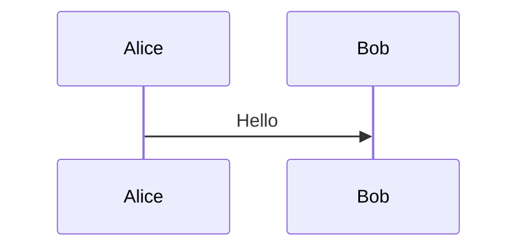

# ADF ↔ Markdown mapping

Jira and Confluence store rich text as Atlassian Document Format (ADF), a JSON tree. ushabti converts every ADF node it fetches into markdown, and every markdown construct it recognizes back into ADF, so ticket descriptions, comments and page bodies can be read and hand-edited as plain markdown files.

The guiding rule: translate into as convenient markdown as possible, losslessly. Where a native markdown or GitHub-flavored-markdown (GFM) construct exists, ushabti uses it, so the file reads naturally and renders correctly on GitHub. Where none exists, it falls back to a sentinel — an HTML comment or a fenced code block carrying just enough information to reconstruct the original ADF node exactly on the way back in. Every mapping below round-trips: download, edit the parts that are plain text, upload, and only the parts you touched change.

## Text and structure

These map onto their obvious markdown equivalent, both directions:

| ADF | Markdown |
|---|---|
| Paragraph | A plain paragraph |
| Heading (levels 1–6) | `#` … `######` |
| Bold / italic / strikethrough / inline code | `**bold**` / `*italic*` / `~~strike~~` / `` `code` `` |
| Link | `[text](url)` |
| Bullet list / ordered list (nested) | `- item` / `1. item` |
| Code block | ` ```lang\ncode\n``` ` |
| Blockquote | `> quoted` |
| Horizontal rule | `---` |
| Hard break | A trailing backslash before the line break |

## Panels (callout boxes)

Panels round-trip through GFM alert syntax — a blockquote whose first line is a `[!TYPE]` marker:

```markdown
> [!WARNING]
> Don't do this in production.
```

| ADF `panelType` | GFM alert |
|---|---|
| `note` | `NOTE` |
| `tip` | `TIP` |
| `info` | `IMPORTANT` |
| `warning` | `WARNING` |
| `error` | `CAUTION` |

`success` and `custom` panel types have no GFM equivalent and degrade to a plain blockquote on download (the type marker is dropped) — markdown has no way to author those back.

## Tables

A GFM pipe table. ADF's first row becomes the header row (GFM requires one); a cell's block content is flattened onto a single line, since GFM table cells can't hold block structure.

## Task lists and decision lists

Task lists use native GFM checkboxes:

```markdown
- [ ] Not done yet
- [x] Done
```

Decision lists have no GFM equivalent, so they use a `[decision]` marker instead:

```markdown
- [decision] Ship it Tuesday
```

## Smart cards and mentions

Inline, block, and embed links to a Jira ticket or Confluence page all round-trip as a markdown link whose title carries a sentinel identifying the card type, so the right ADF node type comes back on upload:

```markdown
[https://acme.atlassian.net/browse/ABC-1](https://acme.atlassian.net/browse/ABC-1 "card")
```

`"card"` is an inline card, `"card-block"` a block card, `"card-embed"` an embed card. A plain link (no title) stays a plain link. Mentions use the same mechanism with the account id as the URL and `"mention"` as the title:

```markdown
[Jane Doe](5f8a1b2c3d4e5f6a7b8c9d0e "mention")
```

## Status lozenges and dates

Both round-trip as an inline code span carrying a sentinel:

```markdown
`[status:In Progress|blue]`
`[date:2026-07-28]`
```

## Multi-column layouts (Confluence)

Each column's blocks are wrapped in HTML-comment sentinel lines:

```markdown
<!-- layout -->

Left column content.

<!-- layout-column -->

Right column content.

<!-- /layout -->
```

Column width ratios aren't representable in markdown; on upload, columns always come back evenly split regardless of the original ratios.

## Expandable sections (Confluence's "Expand" macro)

`expand`/`nestedExpand` render as GitHub's native collapsible section, so they show up correctly on GitHub too:

```markdown
<details>
<summary>Click to expand</summary>

Hidden content.

</details>
```

Both ADF node types round-trip as plain `expand`; `nestedExpand` (used only inside table cells) isn't distinguishable on the way back in, since a table cell's block structure is already flattened by GFM.

## Media (images and other attachments)

An image or file attached to a page/ticket downloads to a local file alongside the page/ticket's own markdown file, named `<page-or-ticket-basename>.<mediaId>.<ext>`, with the extension taken from the attachment's own recorded filename. The body's `attachment:` link is rewritten to point at it:

```markdown

```

Applies to `confluence download` (single page and `--children`), `jira fetch`, and `jira comments` — the read path only. There's no upload path for attaching a brand-new local image back to Confluence or Jira through markdown; uploading a page/ticket only ever touches attachments that already existed when it was downloaded. If a referenced attachment can no longer be matched (deleted, permissions), that one `attachment:` link is left untouched and a warning is printed — the rest of the download still succeeds.

## Macros (Confluence extensions)

A macro with no editable body (`extension`/`inlineExtension`, e.g. a table of contents) is, by default, an opaque passthrough: a fenced code block tagged `confluence-macro` (or an inline code span for an inline macro) holding the macro's full JSON descriptor. Not meant to be hand-authored — it exists so round-tripping never loses a macro ushabti doesn't specifically understand:

````markdown
```confluence-macro
{"extensionKey":"toc",...}
```
````

A macro with an editable body (`bodiedExtension`, e.g. Confluence's generic macro shapes beyond "Expand") wraps its body as ordinary nested markdown between sentinel comments, with only the macro descriptor itself opaque:

```markdown
<!-- confluence-macro {"extensionKey":"...",...} -->

Ordinary markdown body.

<!-- /confluence-macro -->
```

### Plugin-backed macros

Specific macro shapes can opt into a real fenced diagram block instead of opaque JSON, so the diagram source is actually readable and editable — see the [Confluence macro plugins reference](plugins.md) for which macros currently work this way and how a fresh fence picks its plugin:

````markdown
<!-- confluence-plugin {"plugin":"mermaid",...} -->

````

The comment's `plugin` field records exactly which macro produced this fence, so editing the diagram source and uploading round-trips through the *same* macro every time — it never silently swaps implementations. Everything else in that comment is the macro's original attrs, preserved verbatim (theme, macro id, etc.) and spliced back in around your edited diagram source.
